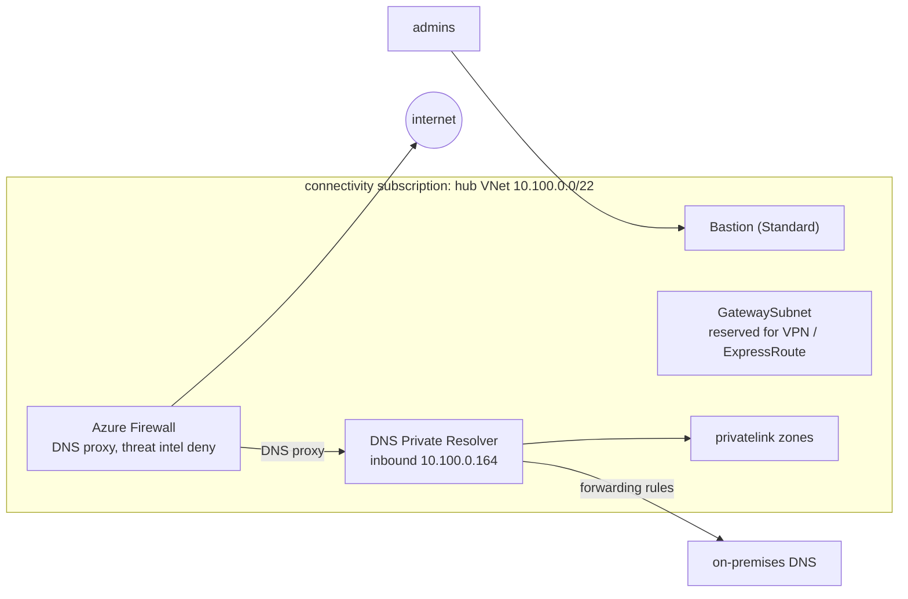

# terraform-azure-landing-zone

[](https://github.com/ozy31/terraform-azure-landing-zone/actions/workflows/ci.yml)


An Azure landing zone in Terraform, following the Cloud Adoption Framework:
the management group hierarchy, policy, a hub network and subscription
vending that application platforms such as
[terraform-azure-aks-platform](https://github.com/ozy31/terraform-azure-aks-platform)
are built on.

> Region, IDs and names are placeholders (UK South). Everything is validated in
> CI without an Azure subscription: Terraform tests use mocked providers.

## Management groups

```
alz                     Retail
├── alz-platform
│   ├── alz-connectivity    hub network, firewall, DNS
│   ├── alz-management      logging, Terraform state
│   └── alz-identity
├── alz-landing-zones
│   ├── alz-corp            private workloads, connected to the hub
│   └── alz-online          internet-facing workloads
├── alz-sandbox             experiments, not connected
└── alz-decommissioned
```

## Hub network



- **Azure Firewall** with a firewall policy: platform rules (NTP, Windows
  Update, Azure Monitor) at priority 200, one rule collection group per landing
  zone above 1000. Threat intelligence in Deny mode; Premium adds IDPS.
- **DNS proxy on the firewall**, so FQDN rules resolve the same addresses as the
  workloads behind it.
- **Central DNS.** Every `privatelink` zone lives once, in the connectivity
  subscription, linked to the hub. Spokes use the firewall as DNS server; the
  firewall proxies to a DNS Private Resolver, which answers from those zones and
  forwards on-premises domains. On-premises forwards Azure names to the
  resolver's fixed inbound address.
- **Bastion Standard** with native client tunnelling: no public IPs on VMs.
- **GatewaySubnet** kept free, so adding VPN or ExpressRoute does not mean
  re-addressing the hub.

## Management

- One Log Analytics workspace in the management subscription for platform
  logs: activity logs of every subscription (landing zones included, through
  vending), firewall logs in resource-specific `AZFW*` tables, Bastion audit
  logs. Entra auth only, resource-context access so teams can query their own
  subscription's activity.
- Alerts on the shared hub, because a firewall problem is an outage for every
  corp landing zone: firewall health below 90%, SNAT port use above 80%.

```kusto
// Top denied egress destinations in the last hour
AZFWApplicationRule
| where TimeGenerated > ago(1h) and Action == "Deny"
| summarize count() by SourceIp, Fqdn
| top 20 by count_
```

## Policy

Assigned to management groups, so a subscription gets its guardrails from
where it is placed. Custom definitions are JSON files in
[`terraform/modules/policy/definitions`](terraform/modules/policy/definitions),
in the same shape as a portal export.

| Scope | Assignment | Effect |
|---|---|---|
| root | Allowed locations, for resources and resource groups (UK South, UK West) | Deny |
| root | `cost-center` tag on resource groups, inherited by resources | Deny, Modify |
| landing-zones | Landing zone baseline initiative: subnet NSG (custom), storage HTTPS only, Key Vault deletion protection, AKS local accounts disabled | Audit, then Deny |
| corp | No public IP addresses (custom) | Deny |
| sandbox | No ExpressRoute, VPN, Virtual WAN or peering | Deny |
| decommissioned | Nothing new but resource groups | Deny |

New guardrails go out audit-only first: list the assignment in
`policy_do_not_enforce`, check the compliance view, then remove it.

## Repository layout

```
terraform/
  modules/
    management-groups/  CAF hierarchy and platform subscription placement (+ tests)
    policy/             custom definitions (JSON), baseline initiative, assignments (+ tests)
    hub-network/        hub VNet, Azure Firewall and policy, Bastion (+ tests)
    private-dns/        central privatelink zones, DNS Private Resolver, forwarding (+ tests)
    management/         central Log Analytics workspace, platform action group (+ tests)
  envs/platform/        composition for the whole tenant (+ tests)
```

## Validation

| Target | What it checks |
|---|---|
| `make terraform` | `fmt`, `init` and `validate` for every module and environment |
| `make tftest` | `terraform test` with mocked providers |
| `make tflint` | tflint with the azurerm ruleset |
| `make lint security` | yamllint, trivy |

## License

MIT
